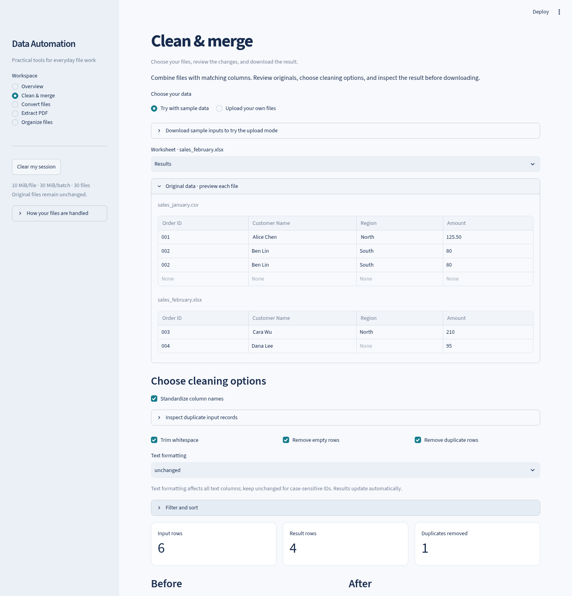
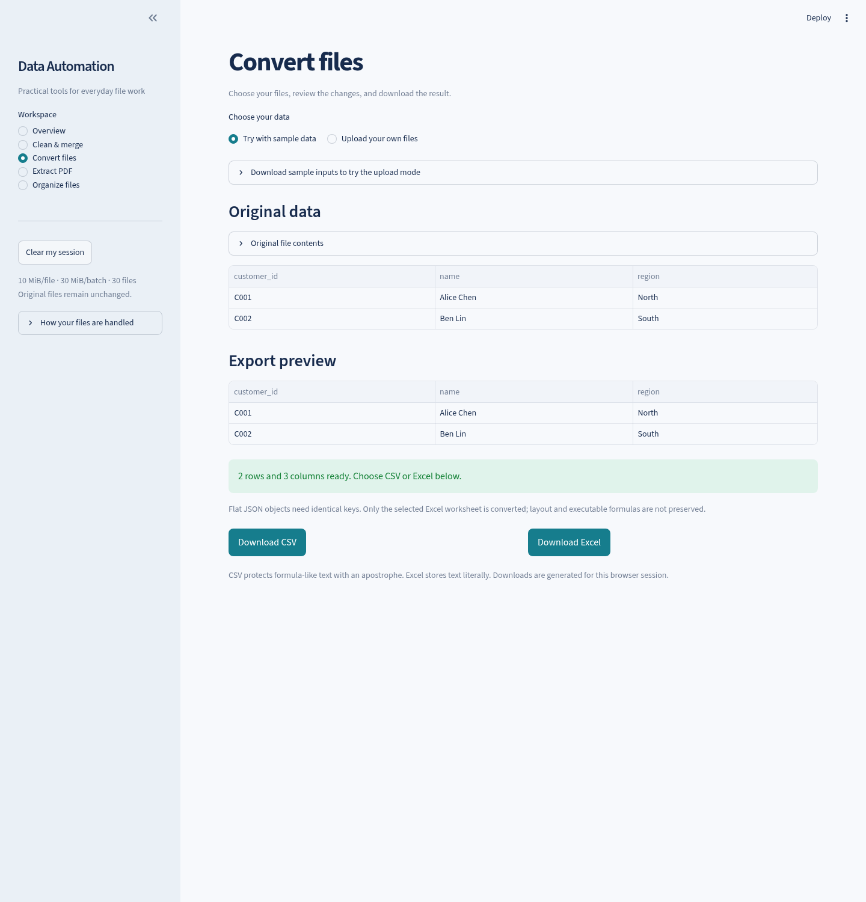
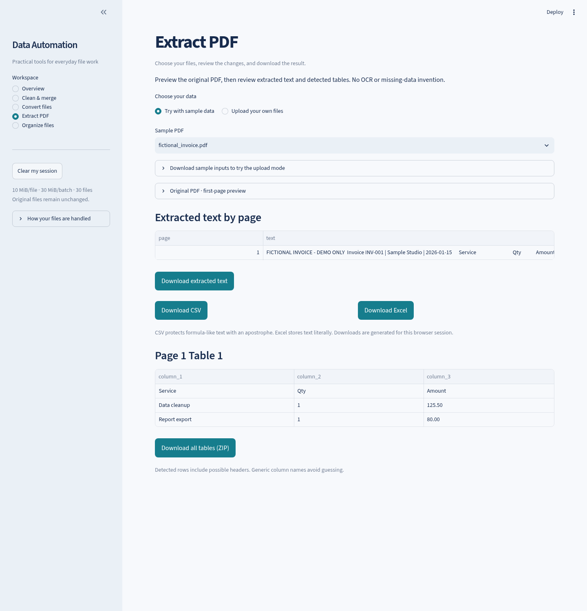

# Universal Data Automation Toolkit

## Live Demo

**[Open the Live Streamlit Demo →](https://minghong-data-toolkit.streamlit.app/)**

Note: This demo is hosted on Streamlit Community Cloud and may take a moment to wake up after a period of inactivity.

1. Select **Clean & merge** in the sidebar (expand the sidebar on mobile).
2. Keep **Try with sample data** selected and review the original sales files.
3. Compare the before/after tables and modification summary, then download CSV or Excel.
4. Explore the other workspaces, or choose **Upload your own files** with non-sensitive test files.

No account or API key is required. PDF extraction uses existing text layers; OCR is not included.

## Project Overview

**Reusable Python workflows for spreadsheet cleaning, file conversion, PDF extraction, and file organization.**

A functional portfolio application that demonstrates how common manual data tasks can become repeatable workflows. Built with Streamlit and UI-independent Python modules, with realistic fictional inputs, downloadable outputs, and automated tests.

> Every workflow offers **Try with sample data** and **Upload your own files**. Public uploads are intended for non-sensitive test files only. This is an independent portfolio project, not a confidential-data service or a claim of paid client work. Read the [data-handling limitations](docs/PRIVACY.md) before using your own files.

## Key Features

- **Clean & merge:** merge compatible CSV/XLSX files, standardize headers, trim text, remove empty/duplicate rows, filter, sort, and preview changes.
- **Data quality:** identify duplicates, report missing cells, and compare before/after tables and modification counts.
- **Convert files:** convert CSV or a selected Excel worksheet to CSV/XLSX, or export compatible flat JSON records to a spreadsheet.
- **Extract PDF:** extract existing text and detected tables; flag pages without a text layer. OCR is not included.
- **Organize files:** preview prefixes, find/replace, numbering, and extension or prefix-rule folders, then download a ZIP.

Original uploads are never renamed or overwritten. Missing values are reported rather than fabricated. See [sample files](samples/README.md), [screenshots](docs/screenshots/README.md), and the [portfolio entry](PORTFOLIO.md).

## Example Use Cases

1. **Consolidate monthly sales exports:** use the supplied sales samples. Six input rows become four after one blank and one duplicate row are removed. ID `001` remains intact, and one missing region remains visible. Inspect before/after results, optionally filter or sort, and download CSV/XLSX.
2. **Prepare data for spreadsheet review:** use the customers JSON sample or a selected XLSX worksheet. Nested JSON and malformed files produce validation errors.
3. **Reduce copying from text-based invoices:** the fictional invoice contains one detectable table and text. Text/page exports and table ZIP outputs are available. Select `scanned_invoice.pdf` in the sample dropdown to see the OCR warning without uploading a file.
4. **Prepare consistently named attachments:** select naming and folder rules, inspect the destination preview, confirm it, and download a new ZIP. Changing the plan resets confirmation.

The portfolio includes a [60-second walkthrough](PORTFOLIO.md) and [client use-case mapping](CLIENT_USE_CASES.md).

## Screenshots

**Spreadsheet cleaning — review inputs and results before downloading.**



<details>
<summary>View format conversion and PDF extraction</summary>

**Format conversion**



**PDF extraction**



</details>

## Technologies Used

- **Python:** reusable processing modules independent of the interface.
- **Streamlit:** browser interface, sample/upload modes, and session controls; hosted on Streamlit Community Cloud.
- **pandas and openpyxl:** tabular cleaning, validation, and CSV/Excel exports.
- **PyMuPDF:** PDF preview, text extraction, and table detection.
- **defusedxml:** hardened XML parsing for Excel inputs.
- **pytest:** automated processing and application checks.

## How to Run Locally

Repository: [minghong777/universal-data-automation-toolkit](https://github.com/minghong777/universal-data-automation-toolkit).

```bash
git clone https://github.com/minghong777/universal-data-automation-toolkit.git
cd universal-data-automation-toolkit
```

The public repository includes the two-mode application. The hosted revision has been verified using fictional samples and uploads.

Use **Python 3.12** to match the verified environment. The source targets Python 3.11+, but other versions have not been validated with this release's full dependency snapshot.

After downloading or cloning this repository, open a terminal inside its project directory:

```bash
python3.12 -m venv .venv
.venv/bin/python -m pip install -r requirements-lock.txt
.venv/bin/python -m streamlit run app.py --server.address 127.0.0.1
```

Open **http://127.0.0.1:8501**. Stop the server with **Ctrl+C**. Every workspace includes fictional sample data and requires no account or API key.

### Ubuntu without Python 3.12

Ubuntu 22.04's default Python 3.10 is too old. Install a separate interpreter using uv rather than replacing the system Python:

```bash
# Run from the project directory. Requires python3-pip.
python3 -m pip install --user uv
"$HOME/.local/bin/uv" python install 3.12
"$HOME/.local/bin/uv" venv --python 3.12 .venv
"$HOME/.local/bin/uv" pip install --python .venv/bin/python -r requirements-lock.txt
.venv/bin/python -m streamlit run app.py --server.address 127.0.0.1
```

For externally managed system Python installations that reject `pip --user`, install uv using its [official installation instructions](https://docs.astral.sh/uv/getting-started/installation/); do not bypass your OS package protections.

### Use sample files or upload your own

1. Select a workflow in the sidebar.
2. Choose **Try with sample data** for ready-to-use fictional examples, or **Upload your own files** to select files from your computer.
3. In sample mode, optionally download the original sample files to try the upload flow. Review original data or the first-page PDF preview and choose processing options.
4. Review the results and download CSV, Excel, TXT or ZIP as applicable.
5. Click **Clear my session** when finished. Switching workflows also resets current uploads/results.

Both modes are enabled by default locally and on Community Cloud. No terminal flag is needed. An owner can explicitly set `TOOLKIT_ALLOW_UPLOADS=false` to temporarily disable uploads.

Files are uploaded to the hosting server, not processed solely inside your browser. Do not upload credentials, account keys, confidential client documents or sensitive personal/financial records to this public demo. Originals are not modified. Session cleanup removes application references and resets controls; it does not erase downloaded files or guarantee immediate secure erasure of framework buffers.

## Tests and reproducible samples

```bash
.venv/bin/python -m pytest -q
.venv/bin/python generate_samples.py
.venv/bin/python scripts/release_check.py
```

The sample generator intentionally regenerates only predefined fictional fixtures under `samples/`; do not store client documents there. The release check reviews Git candidate files and nested sample archives, not ignored local files. Tests rebuild generated fixtures in a temporary directory rather than overwriting committed samples. See [validation evidence](VALIDATION.md) and [release review](docs/RELEASE_REVIEW.md) for results and scope.

Optional real-browser testing uses the normal two-mode local server and Playwright:

```bash
.venv/bin/python -m pip install -r requirements-browser.txt
.venv/bin/python -m playwright install chromium
.venv/bin/python scripts/browser_smoke.py
```

Run the browser script with `--uploads` to exercise real fictional-file uploads, and run `scripts/browser_sessions.py` to check two independent sessions, clearing, malformed uploads and unchanged ZIP content. Both source modes are available in the normal server.

This captures images in `docs/screenshots/` and local test outputs in ignored `artifacts/`. Google Chrome or Chromium is used if installed; otherwise the script uses Playwright's Chromium.

## Project structure

```text
app.py                    Streamlit UI with samples and uploads
toolkit/                  Processing, session state and inline download services
tests/                    Service, safety and Streamlit AppTest checks
samples/input/            Fictional CSV, XLSX, JSON and PDFs
samples/output/           Outputs generated by the actual services
scripts/                  Browser smoke test and release review helper
docs/screenshots/         Curated screenshots and capture guidance
docs/DEPLOYMENT.md         Streamlit Community Cloud instructions
docs/PUBLISHING.md         Beginner-friendly Git and GitHub instructions
PORTFOLIO.md              English Upwork description and demonstration
```

The processing modules are independent of Streamlit and can be adapted to client-specific scripts. The application does not require any paid API, database, external integration, or always-on background worker.

## Data rules and limitations

- **CSV:** UTF-8 or UTF-8-BOM, comma delimiter, consistent row widths, unique nonempty first-row headers. Values stay as text to preserve identifiers. Sorting follows stored types, so CSV numbers sort lexically; numeric filters explicitly parse values.
- **Excel:** `.xlsx` and one selected worksheet only. The first row must contain headers. Legacy `.xls`, macros, encrypted workbooks and complex merged-header layouts are unsupported. Original styles/layout are not preserved. Formulas become literal text; they are never recalculated. Numeric IDs that already lost leading zeros cannot be recovered.
- **Merge/cleaning:** identical column sets are required; column order is aligned. Header collisions after normalization are rejected. Duplicates mean exact whole-row matches after selected transformations. Case conversion affects all text columns and may change case-sensitive IDs. Missing facts are not filled in.
- **JSON:** nonempty arrays of flat objects with identical keys. Nested structures, repeated keys, invalid constants and inconsistent schemas are rejected.
- **PDF:** existing text layers only; no OCR, handwriting recognition, layout guarantees or universal table extraction. Pages without text may be scanned or blank. Detected table rows, including possible headers, are retained with generic column names. Review results against the original.
- **Exports:** CSV neutralizes formula-like text, including headers, by prefixing an apostrophe; those strings intentionally change. XLSX stores text literally and enforces Excel's 32,767-character cell limit. Long PDF text can still be downloaded as TXT/CSV.
- **File organization:** operations affect uploaded copies, never source files. Archives are not extracted. Unsafe paths and case-insensitive destination collisions are rejected. The browser controls where the downloaded ZIP is saved.

## Safety, privacy and scope

Limits: **10 MiB/file, 30 MiB/batch, 30 files, 100,000 data rows, 200 columns, 100 PDF pages, and 2 million extracted text characters**. Workbook archives also have entry-count, expanded-size and compression-ratio checks. DefusedXML hardens Excel XML parsing.

Application code does not intentionally persist uploads or put outputs in shared folders. PDF results are retained only in the current session; other tabular/file processing results are local to the current rerun. No user-data cache is shared across sessions. Downloads and PDF images are delivered inline to that browser session rather than registered at shared media URLs.

OpenPyXL uses temporary worksheet files internally during Excel exports. Explicit cleanup runs after success and failure; crash-proof secure erasure is not guaranteed. **Clear my session** removes the app's references and rotates upload controls; framework-owned buffers, garbage collection, browser copies, swap and provider behavior have separate lifecycles. Public visitors share a server process, not isolated containers.

File limits are not a malware sandbox or a hard per-user resource quota. Complex documents or concurrent visitors can exhaust shared resources. Inline downloads add base64 memory overhead and are capped at 30 MiB per output. This public demo has no client authentication, durable storage, compliance certification or independent penetration test. See [PRIVACY.md](docs/PRIVACY.md) for the complete pre-publication risk statement and intended non-sensitive use.

## Publish and deploy

- [Publish a separate GitHub repository](docs/PUBLISHING.md) — exact commands, staging review, private-first upload and optional public visibility.
- [Deploy to Streamlit Community Cloud](docs/DEPLOYMENT.md) — Python version, dependencies, two-mode configuration, permissions and hosting/privacy limitations.

Live portfolio demo: **https://minghong-data-toolkit.streamlit.app**. Verified on 2026-10-22 with fictional samples/uploads and two independent browser sessions. See [VALIDATION.md](VALIDATION.md) for the tested scope; public testing remains restricted to non-sensitive data.

## License

Source is **AGPL-3.0-or-later**; see [LICENSE](LICENSE). PyMuPDF has an AGPL/commercial licensing model. Review the intended distribution or hosting arrangement before adapting this stack for a closed-source client deliverable; a different PDF library or commercial license may be appropriate. [Upstream licensing information](https://pymupdf.readthedocs.io/en/latest/about.html#license-and-copyright).
