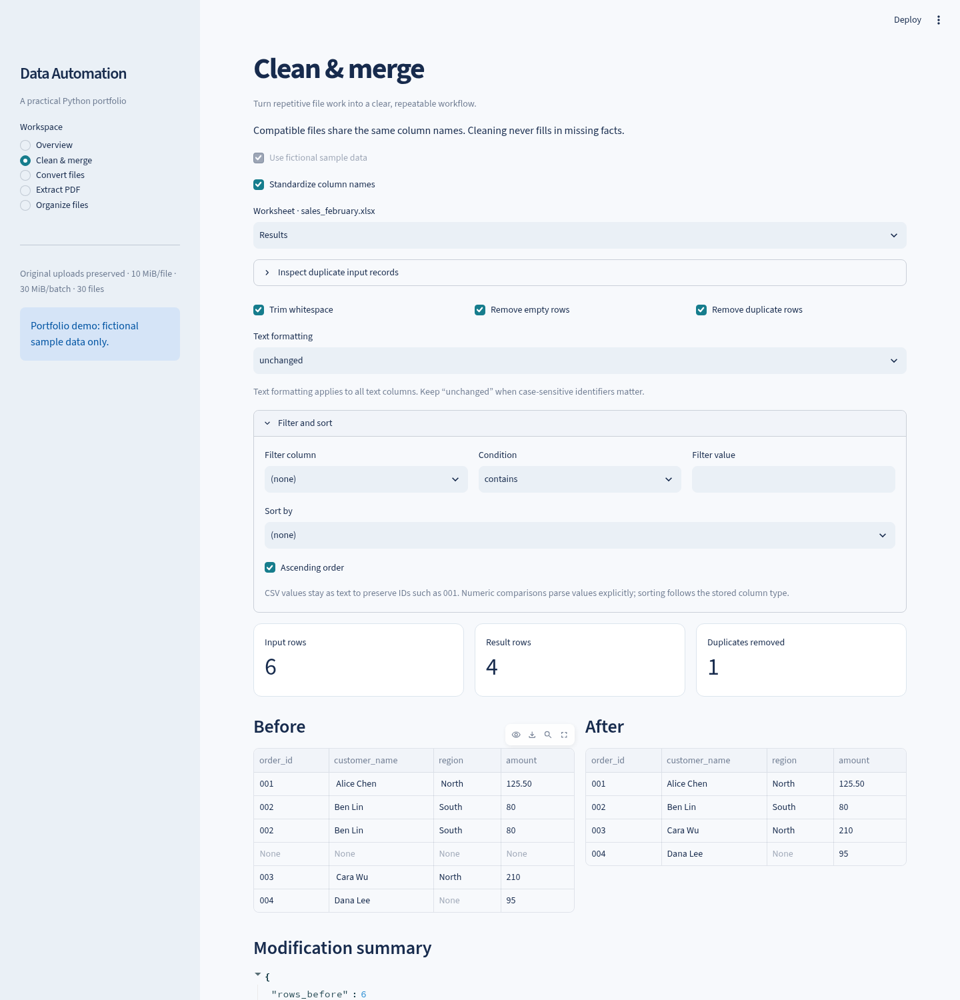

# Universal Data Automation Toolkit

**Reusable Python workflows for spreadsheet cleaning, file conversion, PDF extraction, and file organization.**

A functional portfolio application that demonstrates how common manual data tasks can become repeatable workflows. Built with Streamlit and UI-independent Python modules, with realistic fictional inputs, downloadable outputs, and automated tests.

> The default public demo uses fictional samples only. Enable uploads explicitly for trusted local use. This is an independent portfolio project, not a claim of paid client work or guaranteed business savings.



## Features

| Workflow | Capabilities | Example client problem |
|---|---|---|
| Clean & merge | Merge compatible CSV/XLSX files; standardize headers; trim text; remove empty/duplicate rows; filter and sort; preview changes | Consolidate monthly sales exports without repetitive copying |
| Data quality | Identify duplicate rows; report missing cells; show before/after tables and modification counts | Find incomplete records before importing them into another system |
| Convert files | CSV ↔ selected Excel worksheet; compatible flat JSON → CSV/XLSX | Convert one system's export into a usable spreadsheet |
| Extract PDF | Extract existing text and detected tables; flag pages with no text layer | Reduce manual transcription from consistent text-based reports |
| Organize files | Preview prefixes, find/replace, numbering, extension or prefix-rule folders; download a ZIP | Prepare consistently named project attachments |

Original uploads are never renamed or overwritten. Missing values are reported rather than fabricated. See [sample files](samples/README.md), [screenshots](docs/screenshots/README.md), and the [portfolio entry](PORTFOLIO.md).

## Quick start

Repository: [minghong777/universal-data-automation-toolkit](https://github.com/minghong777/universal-data-automation-toolkit).

```bash
git clone https://github.com/minghong777/universal-data-automation-toolkit.git
cd universal-data-automation-toolkit
```

These clone instructions apply after the owner approves and completes the initial push.

Use **Python 3.12** to match the verified environment. The source targets Python 3.11+, but other versions have not been validated with this release's full dependency snapshot.

After downloading or cloning this repository, open a terminal inside its project directory:

```bash
python3.12 -m venv .venv
.venv/bin/python -m pip install -r requirements-lock.txt
.venv/bin/python -m streamlit run app.py --server.address 127.0.0.1
```

Open **http://127.0.0.1:8501**. Stop the server with **Ctrl+C**. Every workspace includes fictional sample data and requires no account or API key.

### Ubuntu without Python 3.12

Ubuntu 22.04's default Python 3.10 is too old. Install a separate interpreter using uv rather than replacing the system Python:

```bash
# Run from the project directory. Requires python3-pip.
python3 -m pip install --user uv
"$HOME/.local/bin/uv" python install 3.12
"$HOME/.local/bin/uv" venv --python 3.12 .venv
"$HOME/.local/bin/uv" pip install --python .venv/bin/python -r requirements-lock.txt
.venv/bin/python -m streamlit run app.py --server.address 127.0.0.1
```

For externally managed system Python installations that reject `pip --user`, install uv using its [official installation instructions](https://docs.astral.sh/uv/getting-started/installation/); do not bypass your OS package protections.

### Process your own trusted local files

Uploads are deliberately disabled by default. To enable them **only on a trusted local server**, stop the previous process and run:

```bash
TOOLKIT_ALLOW_UPLOADS=true .venv/bin/python -m streamlit run app.py --server.address 127.0.0.1
```

Uncheck **Use fictional sample data** in the chosen workspace and upload your files. Keep private inputs outside the repository, such as in an ignored `private_data/` folder. On a hosted app, uploads would travel to the remote server; “in memory” does not mean “stays on your computer.”

## Usage and demonstration

1. **Clean & merge:** use the supplied sales samples. Six input rows become four after one blank and one duplicate row are removed. ID `001` remains intact, and one missing region remains visible. Inspect before/after results, optionally filter or sort, and download CSV/XLSX.
2. **Convert files:** use the customers JSON sample or a selected XLSX worksheet. Nested JSON and malformed files produce validation errors.
3. **Extract PDF:** the fictional invoice contains one detectable table and text. Text/page exports and table ZIP outputs are available. Select `scanned_invoice.pdf` in the sample dropdown to see the OCR warning without uploading a file.
4. **Organize files:** select naming and folder rules, inspect the destination preview, confirm it, and download a new ZIP. Changing the plan resets confirmation.

The portfolio includes a [60-second walkthrough](PORTFOLIO.md) and [client use-case mapping](CLIENT_USE_CASES.md).

## Tests and reproducible samples

```bash
.venv/bin/python -m pytest -q
.venv/bin/python generate_samples.py
.venv/bin/python scripts/release_check.py
```

The sample generator intentionally regenerates only predefined fictional fixtures under `samples/`; do not store client documents there. The release check reviews Git candidate files and nested sample archives, not ignored local files. See [validation evidence](VALIDATION.md) and [release review](docs/RELEASE_REVIEW.md) for results and scope.

Optional real-browser testing uses the default sample-only local server and Playwright:

```bash
.venv/bin/python -m pip install -r requirements-browser.txt
.venv/bin/python -m playwright install chromium
.venv/bin/python scripts/browser_smoke.py
```

For an additional real-upload check, start the local server with `TOOLKIT_ALLOW_UPLOADS=true` and run the browser script with `--uploads`.

This captures images in `docs/screenshots/` and local test outputs in ignored `artifacts/`. Google Chrome or Chromium is used if installed; otherwise the script uses Playwright's Chromium.

## Project structure

```text
app.py                    Streamlit UI and explicit public-demo mode
toolkit/                  Reusable validation and processing services
tests/                    Service, safety and Streamlit AppTest checks
samples/input/            Fictional CSV, XLSX, JSON and PDFs
samples/output/           Outputs generated by the actual services
scripts/                  Browser smoke test and release review helper
docs/screenshots/         Curated screenshots and capture guidance
docs/DEPLOYMENT.md         Streamlit Community Cloud instructions
docs/PUBLISHING.md         Beginner-friendly Git and GitHub instructions
PORTFOLIO.md              English Upwork description and demonstration
```

The processing modules are independent of Streamlit and can be adapted to client-specific scripts. The application does not require any paid API, database, external integration, or always-on background worker.

## Data rules and limitations

- **CSV:** UTF-8 or UTF-8-BOM, comma delimiter, consistent row widths, unique nonempty first-row headers. Values stay as text to preserve identifiers. Sorting follows stored types, so CSV numbers sort lexically; numeric filters explicitly parse values.
- **Excel:** `.xlsx` and one selected worksheet only. The first row must contain headers. Legacy `.xls`, macros, encrypted workbooks and complex merged-header layouts are unsupported. Original styles/layout are not preserved. Formulas become literal text; they are never recalculated. Numeric IDs that already lost leading zeros cannot be recovered.
- **Merge/cleaning:** identical column sets are required; column order is aligned. Header collisions after normalization are rejected. Duplicates mean exact whole-row matches after selected transformations. Case conversion affects all text columns and may change case-sensitive IDs. Missing facts are not filled in.
- **JSON:** nonempty arrays of flat objects with identical keys. Nested structures, repeated keys, invalid constants and inconsistent schemas are rejected.
- **PDF:** existing text layers only; no OCR, handwriting recognition, layout guarantees or universal table extraction. Pages without text may be scanned or blank. Detected table rows, including possible headers, are retained with generic column names. Review results against the original.
- **Exports:** CSV neutralizes formula-like text, including headers, by prefixing an apostrophe; those strings intentionally change. XLSX stores text literally and enforces Excel's 32,767-character cell limit. Long PDF text can still be downloaded as TXT/CSV.
- **File organization:** operations affect uploaded copies, never source files. Archives are not extracted. Unsafe paths and case-insensitive destination collisions are rejected. The browser controls where the downloaded ZIP is saved.

## Safety, privacy and scope

Limits: **10 MiB/file, 30 MiB/batch, 30 files, 100,000 data rows, 200 columns, 100 PDF pages, and 2 million extracted text characters**. Workbook archives also have entry-count, expanded-size and compression-ratio checks. DefusedXML hardens Excel XML parsing.

Application code processes uploads in server memory and does not intentionally save or send them to third-party services. Dependencies may use managed temporary resources. Uploaded bytes are not logged by this application; browser downloads remain wherever you save them. Streamlit usage telemetry is disabled.

The default sample-only demo is suitable for showing functionality, not for collecting confidential client data. Upload-enabled hosting needs authentication, access control, resource isolation, retention policies and a deployment-specific review. File limits are not antivirus scanning or a malware sandbox. No independent penetration test or compliance certification is claimed.

## Publish and deploy

- [Publish a separate GitHub repository](docs/PUBLISHING.md) — exact commands, staging review, private-first upload and optional public visibility.
- [Deploy to Streamlit Community Cloud](docs/DEPLOYMENT.md) — Python version, dependencies, safe sample-only defaults, permissions and hosting limitations.

There is no live deployment URL until you approve and complete publication. Do not add fake “live demo” links or claim a cloud deployment has been tested.

## License

Source is **AGPL-3.0-or-later**; see [LICENSE](LICENSE). PyMuPDF has an AGPL/commercial licensing model. Review the intended distribution or hosting arrangement before adapting this stack for a closed-source client deliverable; a different PDF library or commercial license may be appropriate. [Upstream licensing information](https://pymupdf.readthedocs.io/en/latest/about.html#license-and-copyright).
